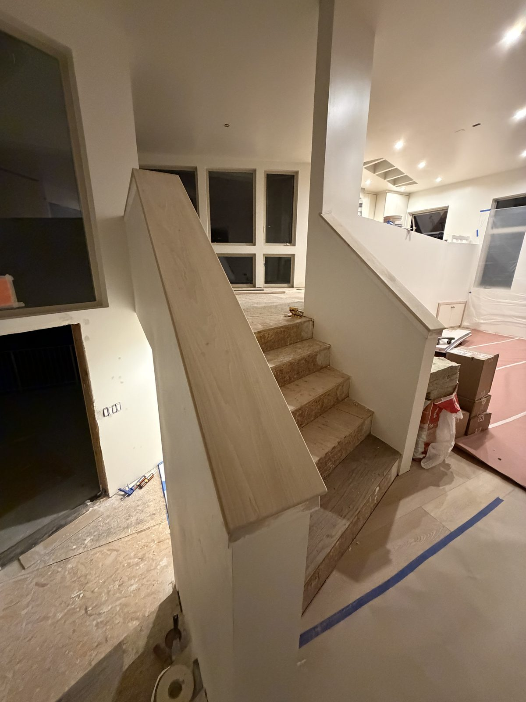
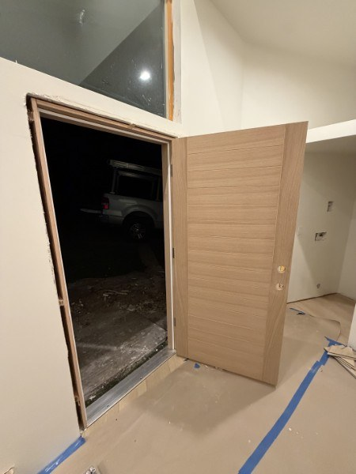

We're in the final push at 498 Orcas.

**The scaffolding finally came down.** You can see the whole house again.

<!-- PHOTO PLACEHOLDER: scaffold-down | caption: Scaffolding gone. -->

**The flooring is finishing up.**

<!-- PHOTO PLACEHOLDER: flooring | caption: Flooring, nearly done. -->

<figure class="full-width"><figcaption>The stairs, with a new white oak cap on the pony wall.</figcaption></figure>

<figure class="full-width"><figcaption>Doors.</figcaption></figure>

**The chandelier is going in.**

<!-- PHOTO PLACEHOLDER: chandelier | caption: Putting in the chandelier. -->

**We're finishing up the bathroom fixtures.**

<!-- PHOTO PLACEHOLDER: bathroom-fixtures | caption: Bathroom fixtures, going in. -->



It's very exciting to see it all come together.



More soon.
