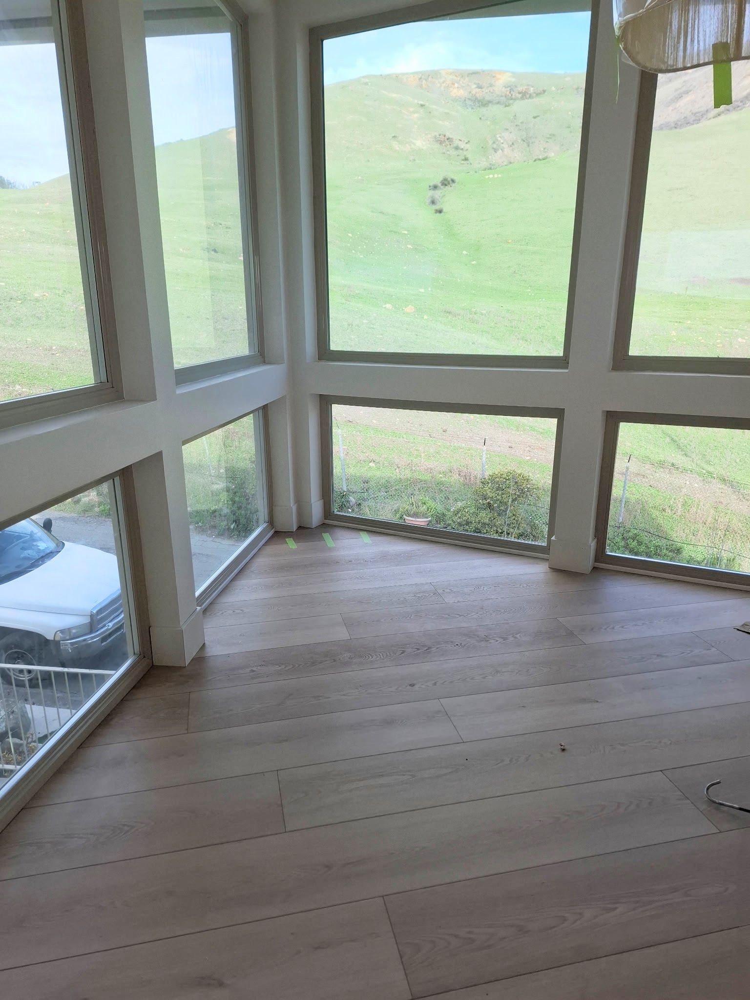
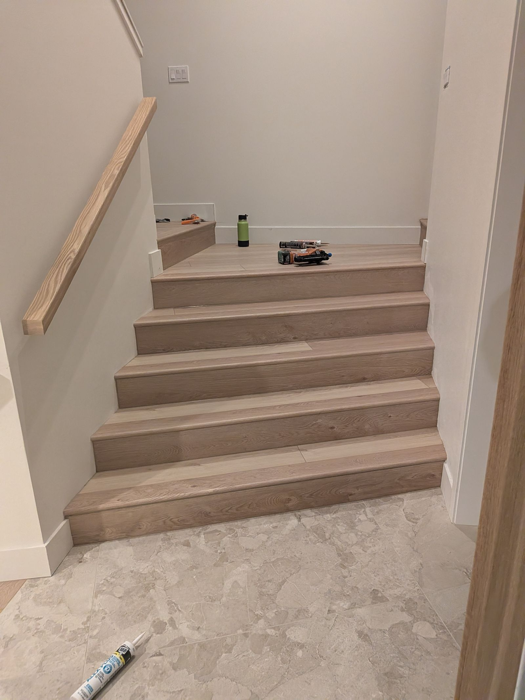
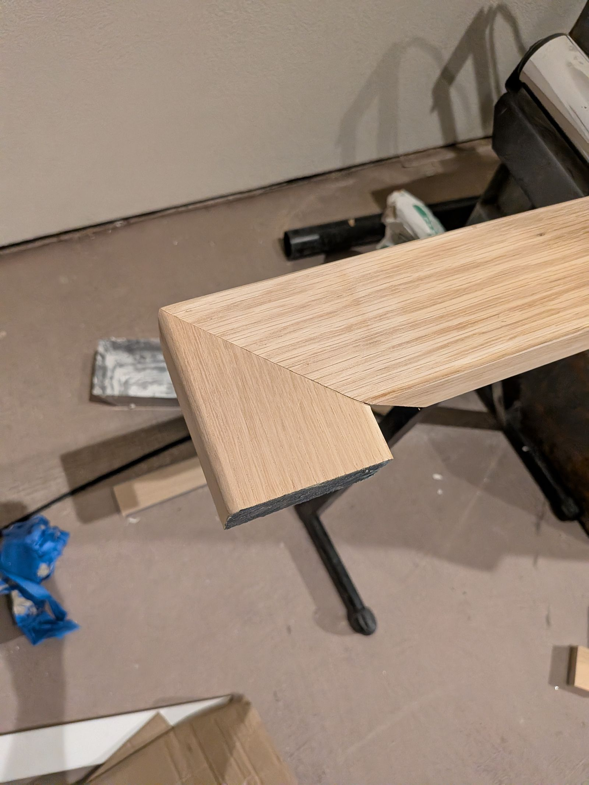
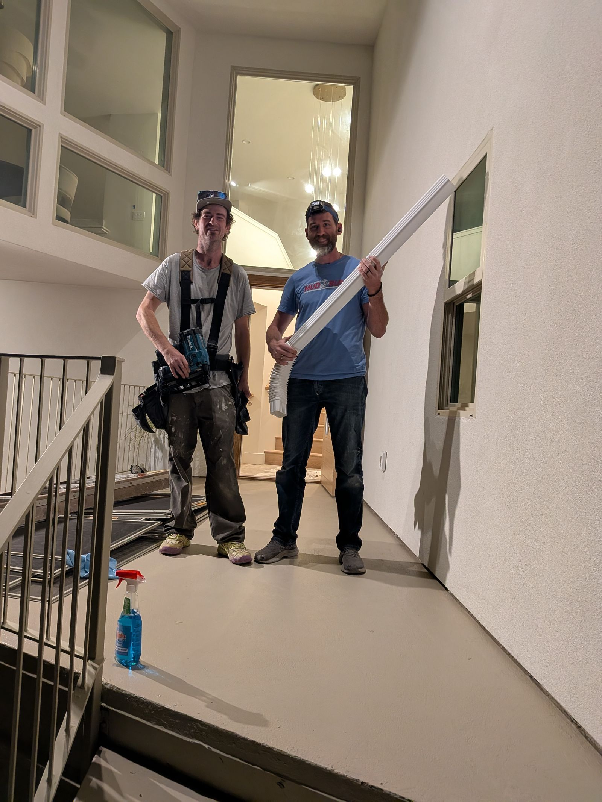
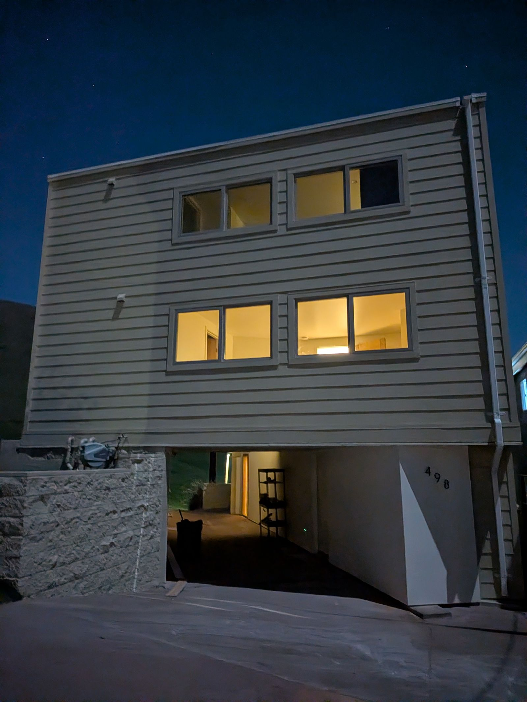
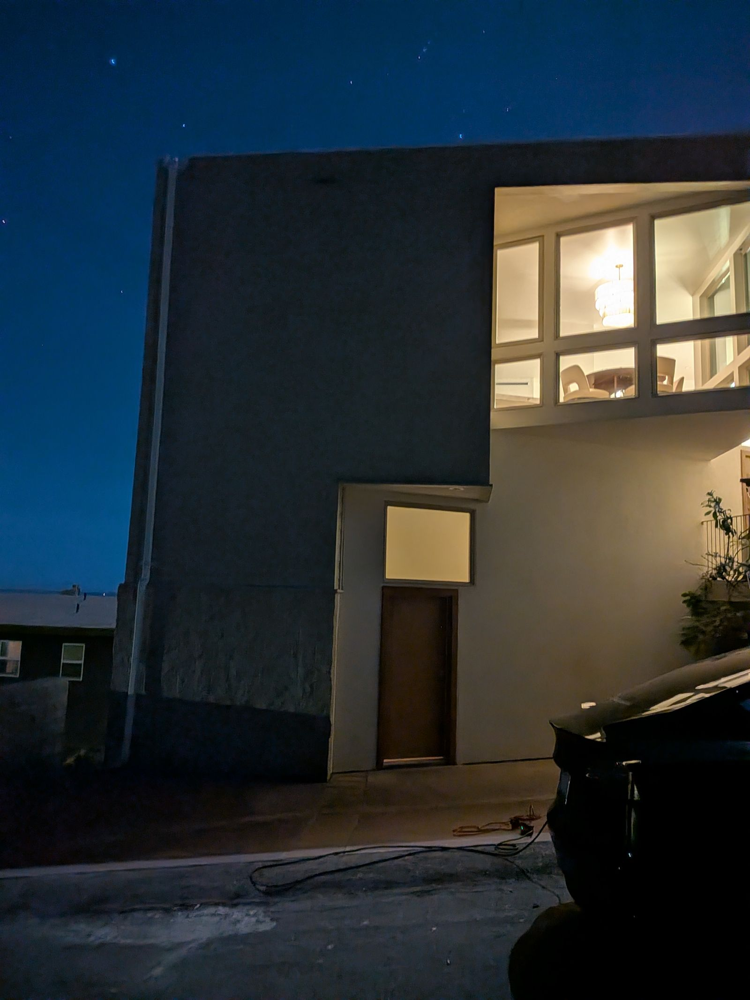

We're in the final push at 498 Orcas. The gutters went in on Nov 25.



**The scaffolding finally came down.** You can see the whole house again.



**The flooring is finishing up.**

<figure class="full-width"><figcaption class="caption-text">Flooring, with a view of the hills.</figcaption></figure>

**The new staircase is in.** Wood-look treads and a natural wood handrail.

<figure class="full-width"><figcaption class="caption-text">The new staircase.</figcaption></figure>

<figure class="full-width"><figcaption class="caption-text">A mitered white oak corner.</figcaption></figure>

**The linear fireplace wall is finished.**



The art is starting to show up, too.



**The gutters are in.**



<figure class="full-width"><figcaption class="caption-text">Gutter pieces, ready to go on.</figcaption></figure>

**The "498" house numbers are up.** You can see them below, on the carport wall, along with the new downspout on the front corner.

<figure class="full-width"><figcaption class="caption-text">The front at night.</figcaption></figure>

**The chandelier is in.** It glows through the big front window.

<figure class="full-width"><figcaption class="caption-text">The entry at night, with the chandelier lit.</figcaption></figure>

Inside, the marble kitchen counters and backsplash are in, with a new stainless fridge. The entry has a cluster of pendant lights, the primary bath has a freestanding tub, and the roof deck looks out toward Morro Rock at sunset.

It's very exciting to see it all come together.



More soon.
